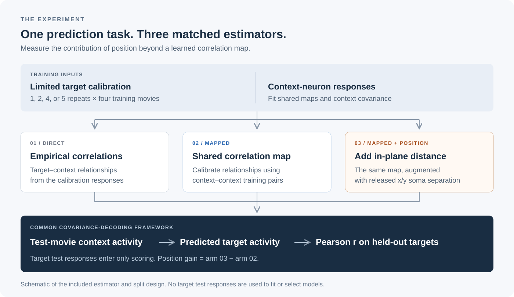
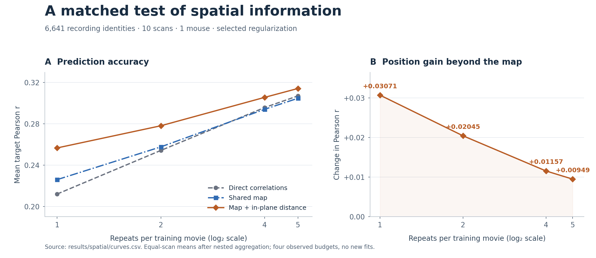

# How Much Neural Data Is Cortical Position Worth?

### How much does a neuron's position help when its responses are scarce?

**Adriano Lima**

A MICrONS study of predicting a held-out neuron's activity from recorded context neurons. The central comparison separates the value of a **shared correlation map** from the additional value of **in-plane soma distance**, then expresses that spatial gain in prediction accuracy and reference-equivalent response repeats.

[Overview](#overview) · [Results](#main-results) · [Methods](#methods-in-brief) · [Repository](#repository-structure) · [Controls](docs/guide.md#controls-and-extended-results) · [Reproduce](#quick-start)



**6,641 recording identities · 10 scans · 5 sessions · 1 mouse**  
**Target budgets: 1, 2, 4, or 5 repeats of each of four training movies**

> At one repeat, adding in-plane distance raises mean target Pearson *r* from **0.226 to 0.257**, a **+0.031** gain beyond the shared map.

## Overview

Neural prediction often has to work with limited responses from the target neuron. Nearby neurons can provide useful information, but the apparent value of position depends on the baseline: some improvement may come from correcting noisy correlations before spatial information is added.

This project uses three matched predictors to make that distinction explicit:

1. **Direct correlations:** estimate target–context relationships from the available calibration responses.
2. **Shared correlation map:** learn a correction using context–context training pairs.
3. **Map + in-plane distance:** add soma separation in the released x/y coordinates to the same mapping.

All three use a common covariance-decoding framework and recorded context activity on a held-out movie to predict the withheld target response. Target test responses are used only for scoring.

## Main results



*Mean target Pearson r, with selected regularization and equal scan weighting after nested aggregation. Lines connect the four measured budgets on a log₂ axis. Table values are rounded to three decimals; retained results keep full precision.*

| Predictor | 1 repeat | 2 repeats | 4 repeats | 5 repeats |
|:--|--:|--:|--:|--:|
| Direct correlations | 0.212 | 0.254 | 0.296 | 0.307 |
| Shared correlation map | 0.226 | 0.258 | 0.294 | 0.305 |
| **Map + in-plane distance** | **0.257** | **0.278** | **0.306** | **0.314** |
| **Position gain beyond the map** | **+0.031** | **+0.020** | **+0.012** | **+0.009** |

- **Position helps across the measured budgets.** The map-plus-distance arm outperforms the map alone in all 10 scans at all four budgets. The aggregate increment is largest when target responses are most limited.
- **One repeat nearly matches two in this comparison.** Map + in-plane distance at one repeat reaches **0.257**, close to the shared map at two repeats (**0.258**).
- **The baseline matters.** At one repeat, the shared map adds +0.014 over direct correlations, and position adds a further +0.031. Crediting both improvements to position would overstate its isolated contribution by about 45%.
- **The gain has a reference-data interpretation.** At one repeat, the shared-map and map-plus-distance scores correspond to **1.259** and **2.083** repeats on the measured low-rank direct reference curve. Their difference, calculated before rounding, is approximately **0.825 additional reference-equivalent repeats**. This quantity depends on the reference; it is not a recording-time estimate.

[Controls, complete numerical summaries, and interpretation →](docs/guide.md#controls-and-extended-results)

## Methods in brief

Six movies rotate through four training movies, one validation movie, and one test movie. Each target receives a limited calibration budget on the training movies. Disjoint repeat pools and outer recording folds separate calibration, shared fitting, and evaluation; model selection uses context-only pseudo-target validation.

The final prediction combines estimated target–context relationships with observed context activity on the held-out movie. Performance is summarized across calibration subsets, allocations, folds, movies, and scans. The [methods and data guide](docs/guide.md#methods-data-and-repository-guide) explains the split design, estimator identifiers, data requirements, and repository layout.

## Interpretation

These results describe **conditional few-shot prediction in one mouse**. The scans and recording identities are repeated measurements, not independent biological replicates. Prediction requires both target calibration responses and held-out-movie context responses. The observed spatial gain is predictive evidence within this design; it does not establish a causal effect of cortical geometry.

## Quick start

With Python 3.10 installed, reproduce the tables and figures from the retained scores:

```bash
git clone https://github.com/Adrianolima01/microns-spatial-priors.git
cd microns-spatial-priors
python3.10 -m venv .venv
source .venv/bin/activate
python -m pip install -r requirements.txt
python -m pip install --no-deps -e .
python scripts/reproduce_paper.py --check
```

Outputs are written to `outputs/paper/`. This route needs no external neural data and does not refit the predictors. See [Getting started](docs/guide.md#getting-started) for tests, Windows activation, and primary-refit requirements.

## Repository structure

```text
microns-spatial-priors/
├── README.md                    # Project overview, results, and repository map
├── assets/readme/               # Pipeline diagram and result figures
├── configs/
│   ├── data/                    # NWB assets, array specifications, units, trials
│   └── splits/                  # Recording folds, movies, repeat pools, pair IDs
├── src/spatial_priors/
│   ├── estimator.py             # Direct, shared-map, and spatial models
│   ├── pipeline.py              # Selection, prediction, scoring, aggregation
│   ├── primitives.py            # Numerical building blocks
│   ├── reference.py             # Low-rank direct reference
│   └── supplementary.py         # Profiles, locations, class and graph features
├── scripts/                     # Data preparation, fitting, and figure generation
├── results/                     # Retained scores and supporting summaries
├── tests/                       # Numerical tests and full-precision fixtures
├── docs/guide.md                # Methods, setup, dictionary, and technical reference
├── CITATION.cff                 # Software citation metadata
└── LICENSE                      # MIT license
```

## Supporting documentation

The [supporting guide](docs/guide.md) keeps the implementation details and scientific specifications together:

1. [Methods, data, and repository guide](docs/guide.md#methods-data-and-repository-guide): experimental design and repository layout
2. [Getting started](docs/guide.md#getting-started)
3. [Results dictionary](docs/guide.md#results-dictionary)
4. [Technical reference](docs/guide.md#technical-reference): reproducibility, data setup specification, figure provenance, citation metadata, and MIT license
5. [Controls and extended results](docs/guide.md#controls-and-extended-results)

The repository includes retained scores and scripts for regenerating the computed tables and figures. Primary-model refitting additionally requires the response arrays described in the guide. The full research write-up will be added separately.

## Citation and license

This project is authored by **Adriano Lima**. Software citation details are in [CITATION.cff](CITATION.cff). Please cite this software and the MICrONS data release when using this work. Code is [MIT-licensed](LICENSE); third-party assets retain their own terms.
